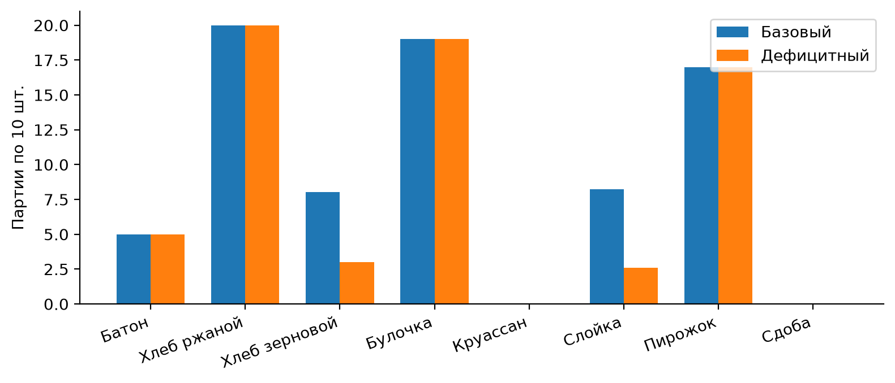
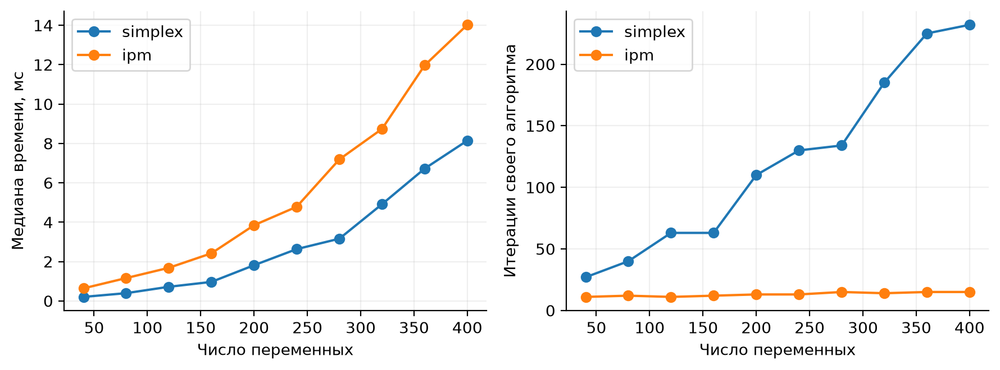

# Лабораторная работа 1

## Ассортимент пекарни с ограничением мощности печей

Песковацков Илья Александрович, Б24-517. Номер в группе 19. Вариант 17. 2026 год.

Дисциплина «Методы оптимизации. Линейное программирование». Работа выполнена по комплексу лабораторных работ А. А. Кузьмина на 2026 год.

## 1 Постановка задачи и индивидуальный вариант

Индивидуальные параметры: N = 19; для группы 517 индекс Q = 1; Y = 26. V = 1 + ((17·19 + 7·1 + 26) mod 20) = 1 + 16 = 17. Seed = 10000 + 100·1 + 19 = 10119. Данные синтетические, учебные; фактические характеристики организаций и оборудования не использовались.

Требуется определить объёмы выпуска восьми изделий на трёх печах за условный двухсуточный период. Максимизируется маржинальная прибыль при ограничениях доступных машиночасов, спроса и обязательных поставок. Базовый оптимум — 44 783 руб.; при снижении доступности первой печи на 20% прибыль падает до 37 975,56 руб. Стрессовый режим несовместим с договорами.

| Изделие | Прибыль руб./партия | Печь 1 ч/партия | Печь 2 ч/партия | Печь 3 ч/партия | Мин. / макс. партий |
| --- | --- | --- | --- | --- | --- |
| Батон | 452 | 0,6 | 0,3 | 0,6 | 5 / 13 |
| Хлеб ржаной | 640 | 0,3 | 0,2 | 0,3 | 4 / 20 |
| Хлеб зерновой | 696 | 0,6 | 0,5 | 0,1 | 3 / 23 |
| Булочка | 656 | 0,4 | 0,4 | 0,2 | 0 / 19 |
| Круассан | 580 | 0,5 | 0,6 | 0,5 | 0 / 18 |
| Слойка | 584 | 0,4 | 0,4 | 0,4 | 0 / 16 |
| Пирожок | 403 | 0,1 | 0,4 | 0,2 | 0 / 17 |
| Сдоба | 439 | 0,4 | 0,6 | 0,4 | 0 / 16 |

Партия содержит 10 изделий. Доступные часы печей: b = (26,42; 27,27; 20,30). Строки таблицы задают заранее фиксированный технологический маршрут: одна партия расходует нормативное время каждой из трёх печей. Это учебная агрегированная модель нескольких стадий обработки, без календарного расписания внутри периода.

## 2 Формальная модель

Множества J = {1,…,8} — изделия, K = {1,2,3} — печи. Параметры: cⱼ — прибыль на партию, руб./партия; aₖⱼ — занятость печи, ч/партия; bₖ — доступность, ч/период; lⱼ и dⱼ — обязательный минимум и предельный спрос, партий/период. Переменные xⱼ непрерывны, партий/период. Прибыль c дана после переменных издержек; постоянные затраты не учитываются.

max P = ∑ⱼ cⱼxⱼ;     ∑ⱼ aₖⱼxⱼ ≤ bₖ для k ∈ K;     lⱼ ≤ xⱼ ≤ dⱼ для j ∈ J

Аддитивность расходов печного времени и постоянная удельная прибыль обеспечивают линейность. Разрешение дробных партий — сознательная непрерывная аппроксимация. Все верхние границы конечны, поэтому допустимая модель ограничена и не может быть unbounded.

## 3 Базовый оптимум и независимая проверка

| Изделие | Базовый план партий | Изделий в период | Дефицитный план партий |
| --- | --- | --- | --- |
| Батон | 5,00 | 50,0 | 5,00 |
| Хлеб ржаной | 20,00 | 200,0 | 20,00 |
| Хлеб зерновой | 8,04 | 80,4 | 3,00 |
| Булочка | 19,00 | 190,0 | 19,00 |
| Круассан | 0,00 | 0,0 | 0,00 |
| Слойка | 8,24 | 82,4 | 2,59 |
| Пирожок | 17,00 | 170,0 | 17,00 |
| Сдоба | 0,00 | 0,0 | 0,00 |

HiGHS вернул Optimal: найден допустимый глобальный максимум линейной модели. Пересчёт по исходной таблице: 452·5 + 640·20 + 696·8,04 + 656·19 + 584·8,24 + 403·17 = 44 783 руб. Круассаны и сдоба не выпускаются.

| Печь | Расход, ч | Лимит, ч | Остаток, ч | Теневая цена руб./ч |
| --- | --- | --- | --- | --- |
| 1 | 26,420 | 26,42 | 0,000 | 1 100 |
| 2 | 27,216 | 27,27 | 0,054 | 0 |
| 3 | 20,300 | 20,30 | 0,000 | 360 |

Функция verify в lab1.py заново читает нормативы, считает суммы aₖⱼxⱼ, проверяет нижние и верхние границы и заново суммирует прибыль. Она не использует residuals, row_value и методы проверки солвера. Максимальное нарушение базового и дефицитного планов — 0; ошибка цели — 0 при допуске 10⁻⁷. Для несовместимого сценария проверяется аналитическое противоречие, а не несуществующий оптимальный вектор.

Нулевой выпуск обусловлен альтернативной стоимостью ресурсов. Двойственная оценка занятости печей для круассана равна 1100·0,5 + 360·0,5 = 730 руб./партию при прибыли 580; для сдобы — 1100·0,4 + 360·0,4 = 584 при прибыли 439. Их включение вытесняет более прибыльный ассортимент. Батон остаётся на договорном минимуме, хотя его свободное расширение также невыгодно.

## 4 Сценарии и теневые цены

| Сценарий | Изменение | Статус | Прибыль, руб. |
| --- | --- | --- | --- |
| Базовый | Исходные часы | Optimal | 44 783,00 |
| Дефицитный | b₁ = 21,136 ч, то есть −20% | Optimal | 37 975,56 |
| Стрессовый | b₁ = 4,8 ч; b₂ = 13,635 ч | Infeasible | Решения нет |

Дефицит снижает прибыль на 6 807,44 руб., или 15,20%. Первыми сокращаются зерновой хлеб и слойка. В стрессе договоры требуют не менее 0,6·5 + 0,3·4 + 0,6·3 = 6 ч первой печи, доступно только 4,8 ч. Из неотрицательности остальных выпусков следует 6 ≤ 4,8 — явное противоречие.

| Изменение b₁, ч | Прогноз 1100·Δb₁, руб. | Факт ΔP, руб. | Ошибка, руб. |
| --- | --- | --- | --- |
| 0,02642 | 29,06 | 29,06 | 0,00 |
| 0,26420 | 290,62 | 166,42 | -124,20 |
| 1,32100 | 1 453,10 | 661,60 | -791,50 |
| -5,28400 | -5 812,40 | -6 807,44 | -995,04 |

В первую очередь выгодно добавлять часы первой печи: её локальная цена 1100 руб./ч против 360 руб./ч третьей и 0 второй. Это справедливо, пока затраты на дополнительный час ниже предельной прибыли и сохраняется базис. Для малого увеличения на 0,1% прогноз совпал с фактом. У второй печи осталось всего 0,054 ч, поэтому уже при росте b₁ на 1% меняется активный набор. Для сокращения на 20% прежняя цена недооценивает потери: зерновой хлеб достигает договорного минимума.

## 5 Практическая интерпретация

План можно использовать как агрегированный ориентир производства и стоимости расширения мощности. Исполнить его буквально нельзя: 8,04 партии — 80,4 изделия; для отдельных выпечек нужны целые изделия, загрузки и смены. Модель не учитывает разогрев, переналадку, совместимость партий, сырьё, персонал, порчу и временную последовательность стадий. Округление требует повторной проверки, а промышленный план — MILP с расписанием. Синтетические нормативы необходимо заменить измеренными перед практическим применением.

## Задание со звёздочкой 1 Сравнение симплекса и IPM

Выполнено также дополнительное задание ЛР 1. Решены 10 сгенерированных ЛП возрастающей размерности. Для каждой задачи одинаковы коэффициенты, границы, presolve и один поток у обоих методов. После прогрева выполнено по три запуска; в таблице медианы. Измеряется только h.run. Исходные матрицы сохранены в benchmark_*_input.json; каждый запуск имеет отдельный лог, все замеры — benchmark_trials.csv.

Генератор PCG64 стартует с seed 10119 и последовательно создаёт n = 40k переменных и m = 15k ограничений для k = 1,…,10. A из U[0,1;1], затем 65% элементов обнуляются; u из U[1;8], c из U[1;30], b = A(0,4u). Точка 0 допустима, верхние границы конечны. Цели обоих алгоритмов и допустимость проверены NumPy.

| n | m | Симплекс, мс | IPM, мс | Ит. симплекс | Ит. IPM |
| --- | --- | --- | --- | --- | --- |
| 40 | 15 | 0,203 | 0,637 | 27 | 11 |
| 80 | 30 | 0,393 | 1,159 | 40 | 12 |
| 120 | 45 | 0,716 | 1,680 | 63 | 11 |
| 160 | 60 | 0,965 | 2,417 | 63 | 12 |
| 200 | 75 | 1,812 | 3,845 | 110 | 13 |
| 240 | 90 | 2,632 | 4,782 | 130 | 13 |
| 280 | 105 | 3,160 | 7,189 | 134 | 15 |
| 320 | 120 | 4,913 | 8,736 | 185 | 14 |
| 360 | 135 | 6,720 | 11,968 | 225 | 15 |
| 400 | 150 | 8,145 | 14,024 | 232 | 15 |

На всех десяти измеренных задачах симплекс оказался быстрее, хотя у IPM меньше внешних итераций. Эти итерации имеют разную стоимость, поэтому их число нельзя считать одинаковыми единицами вычислительной работы. IPM включает crossover; это полный практический путь к базисному решению. Эксперимент не доказывает превосходство симплекса на крупных разреженных задачах иных классов. Подмиллисекундные измерения особенно зависят от нагрузки ОС и накладных расходов.

## Задание со звёздочкой 2 Полная двойственная модель

Нижние границы устраняются заменой z = x − l. Обозначим G вертикальным объединением A и единичной матрицы I₈, h = (b − Al; d − l). Прямая задача: max cᵀl + cᵀz при Gz ≤ h, z ≥ 0. Все исходные ограничения учтены; верхний спрос включён в G и имеет собственные двойственные множители.

Двойственная задача: min D = cᵀl + hᵀy;     Gᵀy ≥ c;     y ≥ 0

Первые три компоненты y = α — цены часов печей; остальные восемь β — цены расширения предельного спроса. Единицы α: руб./ч; β: руб./партия. В явном виде ограничения имеют вид ∑ₖaₖⱼαₖ + βⱼ ≥ cⱼ. Цель: cᵀl + ∑ₖ(bₖ − ∑ⱼaₖⱼlⱼ)αₖ + ∑ⱼ(dⱼ − lⱼ)βⱼ → min.

| Множитель | Оптимальное значение | Экономический смысл |
| --- | --- | --- |
| α₁; α₂; α₃ | 1100; 0; 360 | Предельная прибыль дополнительного часа |
| β батон; ржаной; зерновой | 0; 202; 0 | Дополнительная партия спроса |
| β булочка; круассан; слойка | 144; 0; 0 | Дополнительная партия спроса |
| β пирожок; сдоба | 221; 0 | Дополнительная партия спроса |

Решена отдельная двойственная ЛП, а не только прочитаны тени прямого решения. Постоянная cᵀl = 6908 руб.; остаточные ресурсы b − Al = (20,42; 23,47; 15,80) ч. Двойственная цель: 6908 + 20,42·1100 + 15,80·360 + 16·202 + 19·144 + 17·221 = 44 783 руб. Равенство целей подтверждает оптимальность допустимого прямого плана слабой и сильной двойственностью.

Независимо проверены Gᵀy ≥ c, y ≥ 0 и условия дополняющей нежёсткости: yᵢ(hᵢ − (Gz)ᵢ) = 0 и zⱼ((Gᵀy)ⱼ − cⱼ) = 0. Ошибка равенства целей — 0; максимальная ошибка двойственной допустимости — 0,0000000000001; максимальное произведение в условиях дополняющей нежёсткости — 0,000000000004. Все величины меньше 10⁻⁷.

Нулевая α₂ соответствует свободному ресурсу второй печи. Положительные β ржаного хлеба, булочки и пирожка показывают ценность расширения продаж именно этих изделий. Для батона после сдвига z₁ = 0, поэтому отрицательная приведённая прибыль не нарушает оптимальность обязательного выпуска. Локальные цены не предназначены для экстраполяции через смену базиса.

## Задание со звёздочкой 3 Эластичный фильтр несовместимости

Для стрессового сценария найдено минимальное изменение мощностей, восстанавливающее допустимость без нарушения договорных минимумов. К каждой печи добавлена переменная eₖ ≥ 0, ч. Нормировка на исходные bₖ делает слагаемые сопоставимыми. Это отдельная диагностическая задача, а не скрытое смягчение основной модели.

min E = ∑ₖ eₖ / bₖ;     Ax − e ≤ bˢ;     l ≤ x ≤ d;     e ≥ 0

| Печь | Стрессовый лимит, ч | Минимальная добавка, ч | Новый лимит, ч |
| --- | --- | --- | --- |
| 1 | 4,800 | 1,200 | 6,000 |
| 2 | 13,635 | 0,000 | 13,635 |
| 3 | 20,300 | 0,000 | 20,300 |

Результат: e = (1,2; 0; 0) ч; E = 1,2 / 26,42 = 0,04542014. План x = l допустим после добавки и даёт договорную прибыль 6908 руб.; эта прибыль не является максимумом стрессовой задачи — фильтр минимизирует ремонт ресурсов. Первая печь требует минимум 6 ч при лимите 4,8 ч, следовательно, любое восстановление обязано иметь e₁ ≥ 1,2. Найденный план достигает этой нижней границы, остальные e не нужны. Это аналитическое подтверждение минимальности смещения.

После восстановления независимая функция verify снова проверяет все исходные границы и изменённые часы. Максимальное нарушение равно 0. Результат пригоден для решения о сверхурочной работе или переносе заказа, но цена реального ремонта в модели отсутствует. Нормированный критерий показывает относительное ослабление, а не рублёвую стоимость. Если разрешить перенос договоров или покупку мощности, необходимы согласованные штрафы и новый сценарий.

## Реализация и воспроизводимость

Процедура генерации PCG64(10119): сначала A = integers(1,7,(3,8))/10; затем d = integers(12,25,8); b = round(A·(0,45d),2); далее c = integers(300,701,8). Договорные минимумы l = (5;4;3;0;0;0;0;0) заданы явно. Верхняя граница integers исключена. Реальные входные числа сохранены в JSON, повторная генерация не нужна для обычного запуска.

Модель реализована в lab1.py; общий интерфейс HiGHS — common.py; данные — data/variant.json; генератор — generate_data.py. Функции загрузки, построения или формирования матриц, решения, независимой проверки и отчётности разделены. Одна команда из корня комплекта: python run_all.py. Повторная генерация и расчёт: python run_all.py --generate. Для отдельной работы: python lab1.py.

Среда расчёта: Python 3.12.14; highspy и HiGHS 1.15.1; NumPy 2.3.5; matplotlib 3.11.2. Версии закреплены в requirements.txt; среда и архитектура — environment.json. Один поток; random_seed = 10119; presolve включён; лимит решения 120 с; primal/dual feasibility tolerance = 10⁻⁸; mip feasibility tolerance = 10⁻⁸; mip_rel_gap = 0. Независимая проверка использует допуск 10⁻⁷.

ЛП решаются симплекс-методом HiGHS; в сравнительном эксперименте используется IPM с crossover. MILP решаются встроенным методом ветвей и границ с отсечениями. Время измерено time.perf_counter вокруг h.run без построения модели, чтения данных и графиков. Замеры отражают данную машину и не являются гарантией производительности.

## Ответы к защите

Активны часы первой и третьей печей, верхние границы ржаного хлеба, булочки и пирожка, нижние границы батона и нулевых изделий. Найденная точка является вершиной ограниченного многогранника. При достижимом оптимуме такого многогранника существует оптимальная вершина; для произвольного множества без вершин эта формулировка теоремы неприменима. Альтернативная оптимальность потребовала бы нулевой приведённой стоимости допустимого небазисного направления; один статус Optimal этого не доказывает.

Infeasible означает отсутствие общего допустимого плана; показан конкретный конфликт. Unbounded означал бы направление неограниченного роста прибыли, но конечные d это исключают. Time limit не подтверждает оптимальность: требуется явно сообщить наличие допустимого решения и доказанную границу. Seed и сохранённые JSON восстанавливают входные данные; версии и логи фиксируют алгоритмическую среду, время может изменяться.

## Источники и сдаваемые материалы

1. Кузьмин А. А. Дисциплина «Методы оптимизации. Линейное программирование». Комплекс лабораторных работ, 2026. Предоставленный файл DOCX; общие требования и вариант 17.

2. HiGHS. Официальный интерфейс Python, модели, статусы и логи: https://github.com/ergo-code/highs/blob/master/docs/src/interfaces/python/example-py.md

3. HiGHS. Параметры решателя: https://ergo-code.github.io/HiGHS/stable/options/definitions/ . Использован открытый решатель, проприетарные компоненты отсутствуют.

В папке работы находятся report.pdf, report.md, data/variant.json, README.md и results/. В results/ сохранены реальные логи *.log, модели *.lp, CSV решений и сценариев, summary.json, verification.json и графики PNG. Исходники и requirements.txt находятся в корне репозитория GitHub. Отчёт представлен в PDF для сдачи и в Markdown для просмотра на GitHub. Код, данные и результаты опубликованы вместе с отчётом.
