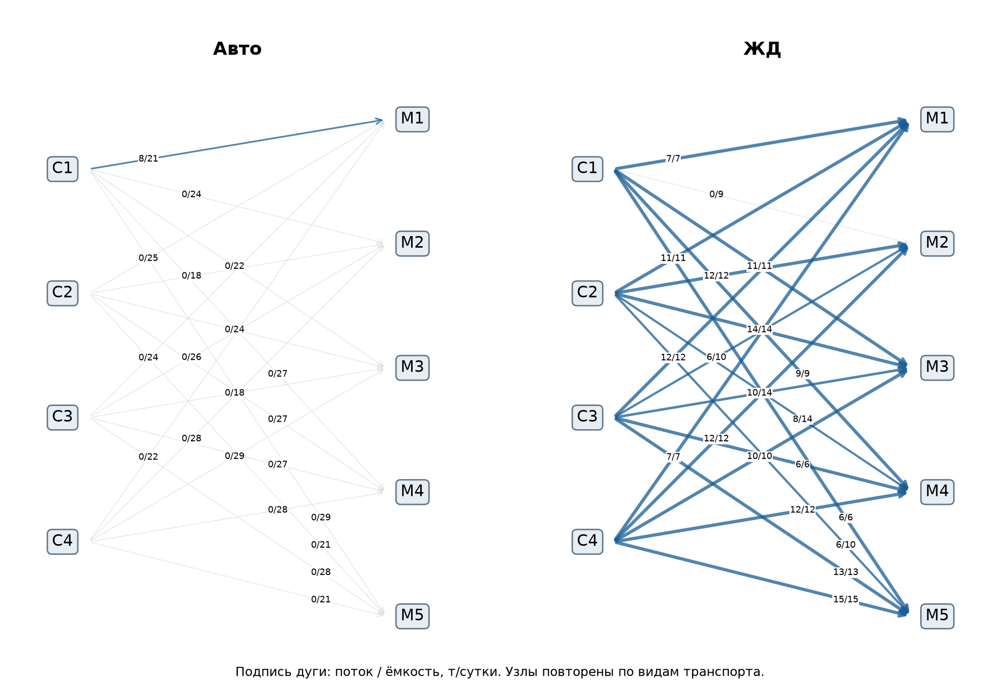
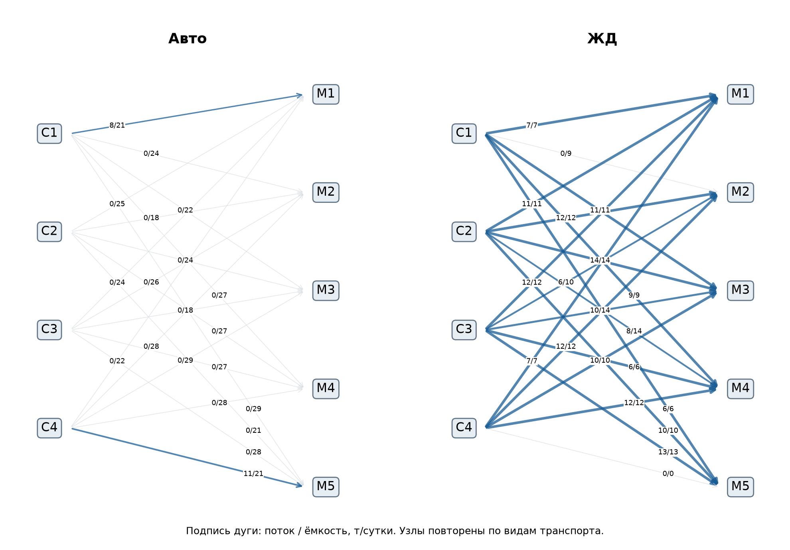

# Лабораторная работа 2

## Перевозки с выбором автомобильного и железнодорожного транспорта

Песковацков Илья Александрович, Б24-517. Номер в группе 19. Вариант 17. 2026 год.

Дисциплина «Методы оптимизации. Линейное программирование». Работа выполнена по комплексу лабораторных работ А. А. Кузьмина на 2026 год.

## 1 Постановка задачи и индивидуальный вариант

Индивидуальные параметры: N = 19; для группы 517 индекс Q = 1; Y = 26. V = 1 + ((17·19 + 7·1 + 26) mod 20) = 1 + 16 = 17. Seed = 10000 + 100·1 + 19 = 10119. Данные синтетические, учебные; фактические характеристики организаций и оборудования не использовались.

Четыре склада снабжают пять магазинов двумя видами транспорта. Требуется полностью покрыть спрос с минимальной стоимостью при ограниченных запасах и ёмкости каждого маршрута. Базовый план перевозит 195 т/сутки за 120 651 руб./сутки. Отказ наиболее загруженной транспортной дуги увеличивает стоимость на 2860 руб./сутки; все потребители продолжают обслуживаться.

| Склад | С1 | С2 | С3 | С4 | Всего |
| --- | --- | --- | --- | --- | --- |
| Запас, т/сутки | 63 | 69 | 59 | 75 | 266 |

| Магазин | М1 | М2 | М3 | М4 | М5 | Всего |
| --- | --- | --- | --- | --- | --- | --- |
| Спрос, т/сутки | 45 | 30 | 45 | 35 | 40 | 195 |

Для каждой пары склад–магазин существуют параллельные дуги «Авто» и «ЖД». В следующей таблице в каждой ячейке указаны тариф, руб./т, и ёмкость, т/сутки. Тарифы разных видов транспорта различны, но внутри каждой дуги постоянны. Фиксированная стоимость отправления, скидки и неделимость рейса не вводятся в основную ЛП.

Автомобильные маршруты

| Склад | М1 | М2 | М3 | М4 | М5 |
| --- | --- | --- | --- | --- | --- |
| С1 | 1244 / 21 | 861 / 24 | 1306 / 22 | 1128 / 27 | 951 / 29 |
| С2 | 1383 / 25 | 1209 / 18 | 1555 / 24 | 1275 / 27 | 1281 / 21 |
| С3 | 1528 / 24 | 1593 / 26 | 1155 / 18 | 801 / 27 | 1066 / 28 |
| С4 | 1388 / 22 | 1230 / 28 | 1006 / 29 | 1225 / 28 | 891 / 21 |

Железнодорожные маршруты

| Склад | М1 | М2 | М3 | М4 | М5 |
| --- | --- | --- | --- | --- | --- |
| С1 | 646 / 7 | 737 / 9 | 625 / 11 | 590 / 9 | 498 / 6 |
| С2 | 536 / 11 | 523 / 12 | 521 / 14 | 733 / 14 | 796 / 10 |
| С3 | 750 / 12 | 665 / 10 | 669 / 14 | 465 / 6 | 507 / 13 |
| С4 | 562 / 7 | 376 / 12 | 645 / 10 | 568 / 12 | 675 / 15 |

## 2 Сетевая структура и формальная ЛП

Множества: I = {С1,…,С4}; J = {М1,…,М5}; M = {Авто, ЖД}. Параметры: aᵢ — запас, т/сутки; dⱼ — спрос, т/сутки; uᵢⱼₘ — ёмкость маршрута, т/сутки; cᵢⱼₘ — тариф, руб./т. Переменные xᵢⱼₘ ≥ 0 — перевозки, т/сутки. Запасы являются верхними границами предложения, поэтому их излишек не нужно уничтожать или везти фиктивному потребителю за ненулевую стоимость.

min C = ∑ᵢ∑ⱼ∑ₘ cᵢⱼₘxᵢⱼₘ

∑ⱼ∑ₘ xᵢⱼₘ ≤ aᵢ;     ∑ᵢ∑ₘ xᵢⱼₘ = dⱼ;     0 ≤ xᵢⱼₘ ≤ uᵢⱼₘ

В реализации добавлены исток S и сток T: дуги S→Сᵢ с ёмкостью aᵢ и дуги Мⱼ→T с фиксированным потоком dⱼ, обе группы с нулевой стоимостью. Итого 11 вершин и 49 дуг, включая 40 реальных транспортных дуг. Баланс Bf = b использует +1 на входе и −1 на выходе, bS = −∑d, bT = ∑d, в остальных вершинах b = 0. Одно балансовое уравнение линейно зависимо; presolve его устраняет. Рисунки показывают только реальные маршруты.

Данные получены PCG64 с seed 10119. Спрос — 5·integers(5,10) для пяти магазинов; запасы — ceil(∑d·(0,32;0,35;0,30;0,38)). Автотарифы integers(800,1601), жд тарифы integers(350,801); ёмкости соответственно integers(18,31) и integers(6,16). В NumPy верхняя граница integers исключена. Порядок генерации зафиксирован исходным кодом; JSON является фактическим входом модели.

## 3 Базовое решение и независимая проверка

Получен статус Optimal, глобальный минимум линейной сети. В таблице указаны потоки «Авто / ЖД», т/сутки. Нулевые потоки оставлены явно.

| Склад | М1 | М2 | М3 | М4 | М5 | Отправлено |
| --- | --- | --- | --- | --- | --- | --- |
| С1 | 8 / 7 | 0 / 0 | 0 / 11 | 0 / 9 | 0 / 6 | 41 |
| С2 | 0 / 11 | 0 / 12 | 0 / 14 | 0 / 8 | 0 / 6 | 51 |
| С3 | 0 / 12 | 0 / 6 | 0 / 10 | 0 / 6 | 0 / 13 | 47 |
| С4 | 0 / 7 | 0 / 12 | 0 / 10 | 0 / 12 | 0 / 15 | 56 |

Всего отправлено по складам (41;51;47;56) т; неиспользованный запас (22;18;12;19) т. Потребители получили (45;30;45;35;40) т. Единственная положительная автоперевозка — 8 т С1→М1, остальные 187 т перевозятся по железной дороге. Наличие резерва складов не снимает локальные ограничения дешёвых железнодорожных маршрутов.

Функция verify в lab2.py независимо пересчитывает полученные и отправленные тонны из тензора x, сверяет поток из истока с отгрузкой каждого склада, спрос в магазинах, баланс истока и стока, неотрицательность, все 40 физических ёмкостей и границы девяти технических дуг. Для технических дуг проверяются фактические значения из вектора решения, включая фиксированные поставки в сток. Стоимость заново суммируется по исходным тарифам. Во всех пяти сценариях максимальный дисбаланс и нарушение границ — 0; ошибка цели — 0. Все 11 балансов по каждому сценарию сохранены в *_balances.csv.

## 4 Перегрузка рост спроса и отказ участка

| Сценарий | Изменение | Статус | Стоимость руб./сутки |
| --- | --- | --- | --- |
| Базовый | Исходные данные | Optimal | 120 651,00 |
| Снижение ёмкости | С2→М1 ЖД: 11 → 8,8 т | Optimal | 122 208,60 |
| Рост спроса | Весь спрос +20%: 234 т | Optimal | 155 634,00 |
| Отказ дуги | С4→М5 ЖД: 15 → 0 т | Optimal | 123 511,00 |
| Комбинированный стресс | Спрос +20% и тот же отказ | Optimal | 158 874,00 |

Перегрузка моделируется снижением ёмкости экономически наиболее дорогого узкого места на 20%. Рост спроса на 39 т увеличивает стоимость на 34 983 руб. (29,00%); рост затрат быстрее объёма связан с исчерпанием дешёвых дуг и переходом на автоперевозки. Общий запас 266 т превышает 234 т, а ёмкости сети позволяют покрыть спрос, поэтому модель остаётся допустимой.

Самая загруженная реальная дуга по абсолютному потоку — С4→М5 ЖД: 15 т/сутки. Из дуг со 100% загрузкой она переносит больше всего тонн. После её закрытия стоимость становится 123 511 руб./сутки: ущерб 2860 руб., или 2,37%. Технические дуги истока и стока не считаются физическими участками доставки. Новый план полностью проверен; его схема приведена ниже.

## 5 Узкие места и двойственная интерпретация

В оптимуме насыщены 15 транспортных дуг. Насыщенность сама по себе не гарантирует положительную ценность расширения: необходима ненулевая двойственная оценка границы. В CSV сохранены оценки для всех маршрутов.

| Дуга | Поток / ёмкость, т | ∂C/∂u, руб./т |
| --- | --- | --- |
| С2→М1 ЖД | 11 / 11 | -708 |
| С4→М1 ЖД | 7 / 7 | -682 |
| С1→М1 ЖД | 7 / 7 | -598 |
| С3→М1 ЖД | 12 / 12 | -494 |
| С1→М5 ЖД | 6 / 6 | -298 |
| С3→М5 ЖД | 13 / 13 | -289 |

Двойственная цена ёмкости С2→М1 ЖД равна −708 руб./т: небольшое расширение снижает минимальные расходы. Эксперимент +0,01 т даёт прогноз −7,08 руб. и фактическое изменение −7,08 руб. В задаче минимума отрицательный знак цены верхней границы означает экономию от расширения.

Для баланса «вход − выход» потенциалы π дают приведённую стоимость cᵤᵥ + πᵤ − πᵥ. Например, πС2 = −1244, πМ1 = 0; тариф 536, поэтому приведённая стоимость 536 − 1244 = −708. Дуга находится на верхней границе, а увеличение её ёмкости позволяет получить именно эту локальную экономию. Потенциалы определены с точностью до общей добавки; изменение всех π на одну константу не меняет разностей. Полный набор — node_potentials.csv.

## 6 Жадная эвристика и целочисленное расширение

Эвристика сортирует все 40 маршрутов по возрастанию тарифа, затем отправляет min(остаток склада, остаток спроса, ёмкость дуги). При равенстве тарифов сохраняется исходный порядок маршрутов. После прохода отдельно проверяется неудовлетворённый спрос; стоимость неполного плана нельзя сравнивать с допустимым оптимумом.

| Сценарий | ЛП, руб. | Жадный, руб. | Зазор, % | ЛП / жадный, мс |
| --- | --- | --- | --- | --- |
| Базовый | 120 651,00 | 120 651,00 | 0,00 | 0,341 / 0,070 |
| Снижение ёмкости | 122 208,60 | 122 208,60 | 0,00 | 0,246 / 0,053 |
| Рост спроса | 155 634,00 | 155 634,00 | 0,00 | 0,216 / 0,052 |
| Отказ дуги | 123 511,00 | 123 511,00 | 0,00 | 0,220 / 0,051 |
| Комбинированный стресс | 158 874,00 | 158 874,00 | 0,00 | 0,209 / 0,051 |

На этих пяти входных наборах жадная эвристика допустима и достигла оптимума: зазор 0%. Это свойство данных, а не гарантия метода. Контрпример: две единицы предложения и спроса, тарифы [[1,2],[2,100]]. Выбор самой дешёвой клетки даёт 101, тогда как перекрёстный план стоит 4. Эвристика не учитывает будущую альтернативную стоимость ограниченных запасов. Разница времени здесь мала и измерена однократно; статистический вывод о быстродействии не делается.

Выполнено дополнительное задание: все потоки сделаны целыми в условных неделимых единицах по 1 т. Базовый MILP дал те же 120 651 руб.; ошибка целочисленности равна 0. Время LP 0,341 мс, MILP 4,043 мс. Причина совпадения — полная унимодулярность матрицы инцидентности ориентированной сети и целые правые части и границы. Параллельные дуги этого не нарушают. Целочисленный поток в 1-тонных единицах не является расписанием реальных грузовиков или вагонов: для разных размеров рейса нужна другая модель.

## 7 Вывод и практическая реализуемость

Главный резерв — пропускная способность дешёвых железнодорожных направлений, а не увеличение складского запаса. Базовый план устойчив к проверенному единичному отказу, но спрос +20% увеличивает стоимость на 29%. Можно реализовать непрерывные тоннажи при делимом грузе и доступности обоих видов транспорта. Перед исполнением нужны фактические станции и подъездные пути, длительности, графики отправлений, вместимость рейса, сроки доставки и стоимость перегрузки. Потери, задержки и фиксированные сборы в этой ЛП отсутствуют.

## Реализация и воспроизводимость

Модель реализована в lab2.py; общий интерфейс HiGHS — common.py; данные — data/variant.json; генератор — generate_data.py. Функции загрузки, построения или формирования матриц, решения, независимой проверки и отчётности разделены. Одна команда из корня комплекта: python run_all.py. Повторная генерация и расчёт: python run_all.py --generate. Для отдельной работы: python lab2.py.

Среда расчёта: Python 3.12.14; highspy и HiGHS 1.15.1; NumPy 2.3.5; matplotlib 3.11.2. Версии закреплены в requirements.txt; среда и архитектура — environment.json. Один поток; random_seed = 10119; presolve включён; лимит решения 120 с; primal/dual feasibility tolerance = 10⁻⁸; mip feasibility tolerance = 10⁻⁸; mip_rel_gap = 0. Независимая проверка использует допуск 10⁻⁷.

ЛП решаются симплекс-методом HiGHS; в сравнительном эксперименте используется IPM с crossover. MILP решаются встроенным методом ветвей и границ с отсечениями. Время измерено time.perf_counter вокруг h.run без построения модели, чтения данных и графиков. Замеры отражают данную машину и не являются гарантией производительности.

## Ответы к защите

Сеть является ЛП, поскольку сохраняется аддитивный поток, постоянны тарифы и заданные границы. Теневая цена дуги показывает локальную экономию её расширения; потенциалы характеризуют узлы, но экономический смысл имеют их разности. Базовая ЛП имеет целочисленную вершину по сетевой структуре, хотя переменные объявлены непрерывными. При неделимых объектах с дополнительными связками или фиксированными сборами эта гарантия может исчезнуть.

Все проверенные статусы Optimal означают допустимый минимум. Если после отказа суммарная ёмкость некоторого разреза станет меньше требуемого потока, получится Infeasible; тогда нужно показать дефицит разреза или использовать диагностику ограничений. Unbounded здесь исключён конечными ёмкостями. Для Time limit нельзя выдавать лучший найденный план за доказанный оптимум.

## Источники и сдаваемые материалы

1. Кузьмин А. А. Дисциплина «Методы оптимизации. Линейное программирование». Комплекс лабораторных работ, 2026. Предоставленный файл DOCX; общие требования и вариант 17.

2. HiGHS. Официальный интерфейс Python, модели, статусы и логи: https://github.com/ergo-code/highs/blob/master/docs/src/interfaces/python/example-py.md

3. HiGHS. Параметры решателя: https://ergo-code.github.io/HiGHS/stable/options/definitions/ . Использован открытый решатель, проприетарные компоненты отсутствуют.

В папке работы находятся report.pdf, report.md, data/variant.json, README.md и results/. В results/ сохранены реальные логи *.log, модели *.lp, CSV решений и сценариев, summary.json, verification.json и графики PNG. Исходники и requirements.txt находятся в корне репозитория GitHub. Отчёт представлен в PDF для сдачи и в Markdown для просмотра на GitHub. Код, данные и результаты опубликованы вместе с отчётом.
